# Data model (concise ER diagram)

Full schema: `apps/api/prisma/schema.prisma`; integrity/RLS SQL: `apps/api/prisma/migrations/*_rls_and_integrity`.
Every tenant-owned table carries `tenantId`, is protected by PostgreSQL RLS, and references other tenant rows
through composite `(tenantId, id)` foreign keys so cross-tenant links are impossible even for privileged writes.

```mermaid
erDiagram
  USER ||--o{ MEMBERSHIP : has
  USER ||--o{ SESSION : has
  SESSION ||--o{ REFRESH_TOKEN : rotates
  USER ||--o| PLATFORM_ADMIN : "may be"
  USER ||--o| ONBOARDING_DRAFT : resumes
  TENANT ||--o{ MEMBERSHIP : has
  TENANT ||--o{ BRANCH : "has (1 primary today)"
  TENANT ||--o{ TENANT_SERVICE : enables
  SERVICE_DEFINITION ||--o{ TENANT_SERVICE : "platform catalog"
  TENANT ||--o{ CUSTOM_SERVICE_DEFINITION : defines
  TENANT ||--o{ CUSTOMER : owns
  TENANT ||--o{ SERVICE_RECORD : owns
  CUSTOMER |o--o{ SERVICE_RECORD : "optional (walk-ins allowed)"
  CUSTOM_SERVICE_DEFINITION |o--o{ SERVICE_RECORD : "for CUSTOM"
  SERVICE_RECORD ||--o{ RECORD_STATUS_EVENT : "append-only history"
  SERVICE_RECORD ||--o{ PAYMENT_ALLOCATION : "settled by"
  COLLECTION ||--o{ PAYMENT_ALLOCATION : allocates
  SERVICE_RECORD ||--o{ FOLLOW_UP_TASK : "follow-ups"
  CUSTOMER ||--o{ FOLLOW_UP_TASK : "follow-ups"
  TENANT ||--o{ ATTACHMENT : "private files (owner = record/customer/payment/logo)"
  TENANT ||--o{ LEDGER_ACCOUNT : "chart of accounts"
  JOURNAL_ENTRY ||--|{ JOURNAL_LINE : "balanced lines"
  LEDGER_ACCOUNT ||--o{ JOURNAL_LINE : posts
  JOURNAL_ENTRY |o--o| JOURNAL_ENTRY : "reversal link"
  SERVICE_RECORD ||--o{ JOURNAL_ENTRY : "source (record:id:seq)"
  COLLECTION ||--|| JOURNAL_ENTRY : source
  EXPENSE ||--|| JOURNAL_ENTRY : source
  COMMISSION_RECEIPT ||--|| JOURNAL_ENTRY : source
  TENANT ||--o{ DAILY_CLOSING : "one per business date"
  PLAN ||--o{ PLAN_VERSION : versioned
  TENANT ||--|| SUBSCRIPTION : has
  PLAN_VERSION ||--o{ SUBSCRIPTION : "subscribers"
  SUBSCRIPTION ||--o{ SUBSCRIPTION_EVENT : history
  TENANT ||--o{ ENTITLEMENT_OVERRIDE : "admin overrides"
  TENANT ||--o{ USAGE_COUNTER : "per metric + month"
  TENANT ||--o{ USAGE_ADJUSTMENT : "idempotent"
  TENANT ||--o{ PAYMENT_SUBMISSION : "manual SaaS payments"
  TENANT ||--o{ CONNECTOR_CONFIG : "encrypted credentials"
  SERVICE_RECORD ||--o{ PROVIDER_OPERATION : "provider-linked only"
  PROVIDER_OPERATION ||--o{ PROVIDER_OPERATION_EVENT : history
  RECONCILIATION_RUN ||--o{ RECONCILIATION_EXCEPTION : finds
  TENANT ||--o{ NOTIFICATION : receives
  TENANT ||--o{ EXPORT_JOB : requests
  TENANT ||--o{ SUPPORT_ACCESS_SESSION : "visible to tenant"
  TENANT |o--o{ AUDIT_EVENT : "append-only"
```

Platform-level tables (no tenant RLS): `users`, `sessions`, `refresh_tokens`, `otp_challenges`,
`onboarding_drafts`, `platform_admins`, `service_definitions`, `plans`, `plan_versions`, `idempotency_records`,
`outbox_events`, `webhook_receipts` (tenant resolved only after signature verification), `announcements`,
`platform_settings`, `email_logs` (recipient hashed + masked).

## Key constraints

- `service_records (tenantId, recordNo)` unique — human-friendly per-shop numbering via atomic `tenant_counters`.
- `service_records (tenantId, clientRef)` unique — mobile offline drafts can never create duplicates.
- `journal_entries (tenantId, postingKey)` unique — no duplicate posting; `(tenantId, entryNo)` unique.
- `journal_lines` CHECK exactly one positive side; deferred trigger: every entry balances with ≥ 2 lines.
- `daily_closings (tenantId, businessDate)` unique; trigger blocks entries into closed dates.
- `usage_counters (tenantId, metric, periodKey)` PK; atomic conditional upsert enforces quotas.
- `provider_operations (tenantId, idempotencyKey)` and `(provider, providerRef)` unique; `webhook_receipts (provider, deliveryId)` unique.
- Optimistic concurrency: `version` columns on records, customers, follow-ups, memberships, tenants, closings, subscriptions, plan admin rows.
- Money CHECKs: non-negative amounts on records; positive amounts on collections, allocations, expenses.

## Deletion and soft-delete policy

- Financial rows (journal, collections, allocations, expenses, commission receipts, closings) are never deleted;
  corrections are reversals. Records are never deleted (cancel/fail + reverse instead).
- Customers are _archived_ (soft) — history stays linked. Attachments are soft-deleted (`deletedAt`).
- Audit and status-event tables are append-only (enforced in the database).
- Tenant deletion is an explicit admin process (`PENDING_DELETION` → retention window → runbook purge); see
  `docs/DATA_RETENTION.md`.
